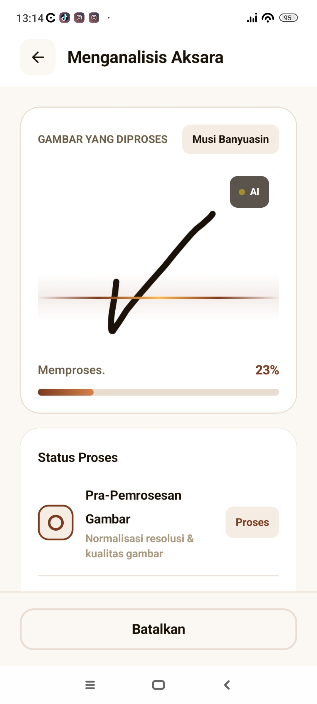
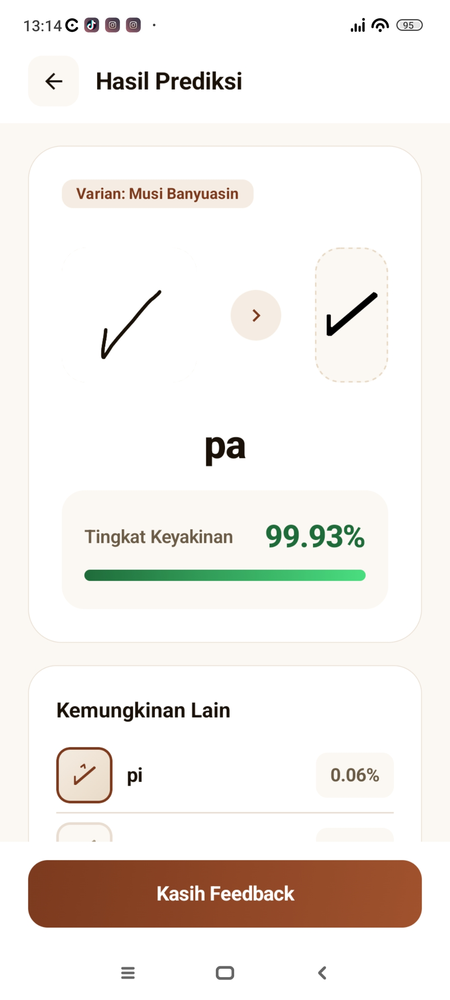
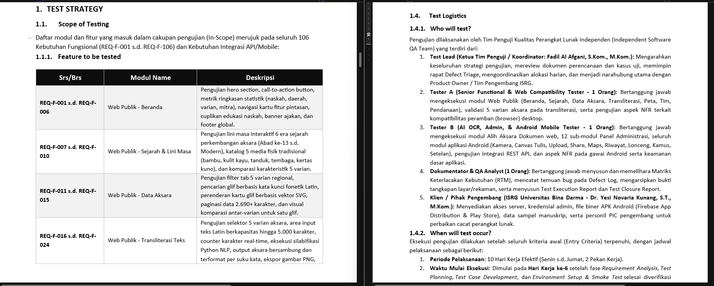
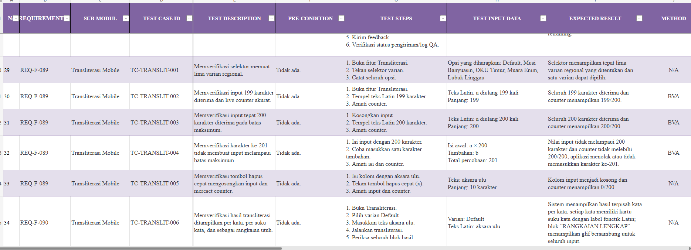
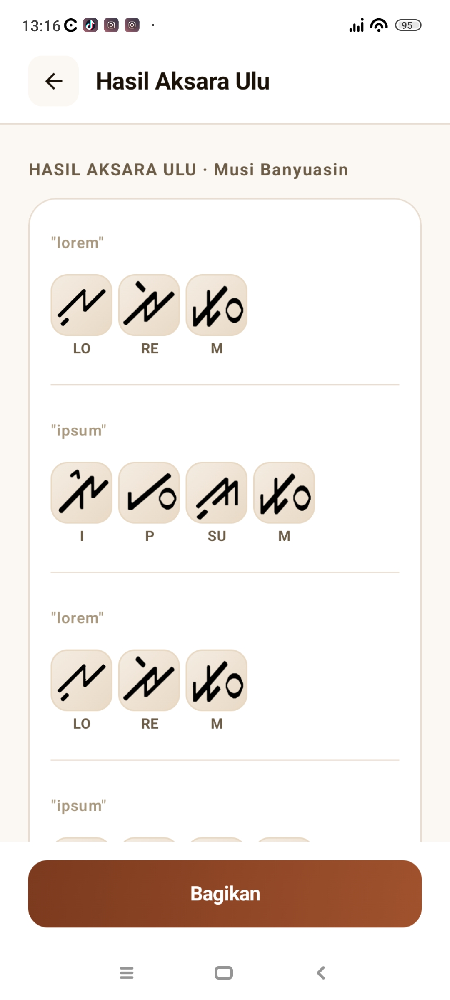
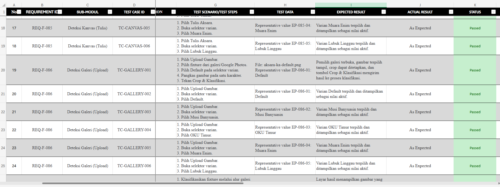
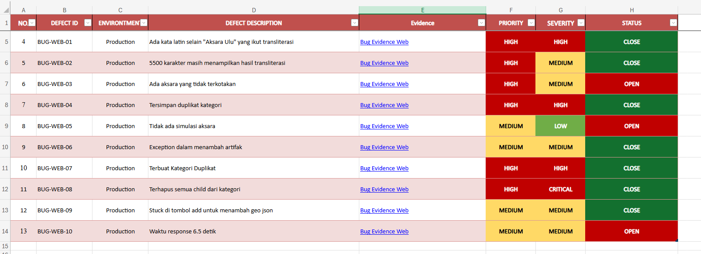
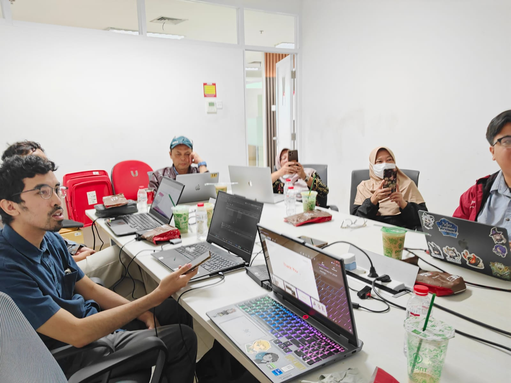
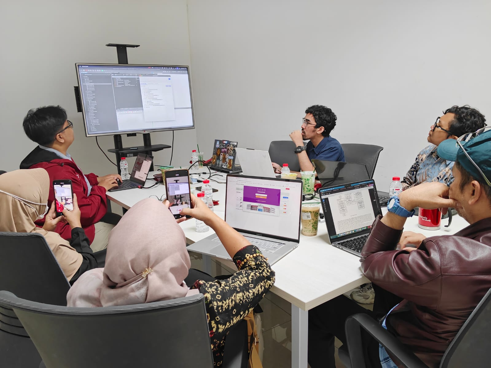

## Project overview

Aksara Ulu (Kaganga) is a web and mobile application developed by Universitas Bina Darma. It supports the introduction and classification of Ulu characters, as well as the translation of Latin text into Ulu script.

Universitas Bina Darma engaged our external software testing team to test the application. I joined as a Software Quality Assurance team member, with primary responsibility for mobile testing. My involvement began with requirements analysis and continued through testing documentation and closure.

<!-- Pindahkan gambar beserta caption untuk mengubah posisi pada halaman. -->

*Application screens showing character processing and a prediction result. The displayed confidence belongs to that individual prediction, not a measured overall accuracy or QA result.*

## My role and testing scope

My contribution was quality assurance within the external testing team. Universitas Bina Darma was the client and application developer.

I worked with the developer's requirements to understand expected behavior and prepare tests for both functional requirements (FR) and non-functional requirements (NFR). The agreed testing scope guided the planning, test design, environment preparation, and execution activities.

## From requirements to test cases

### Requirement analysis and planning

I reviewed the system requirements supplied by the developer to understand the application's intended behavior and quality requirements. I then participated in test planning based on those requirements and the scope agreed with the team.

*An excerpt from the team's test plan. The scope and responsibilities shown cover the wider testing team; my primary responsibility was mobile testing.*

### Requirement-based test design

I prepared test cases covering functional and non-functional requirements. A black-box approach guided testing of externally observable behavior, with techniques selected according to the characteristics of each requirement.

Functional and non-functional requirements called for appropriate checks of their own. The test design approach depended on what needed to be evaluated, rather than applying one technique to every requirement.

*Requirement-based mobile test cases, including boundary checks for text input.*

## Mobile environment and execution

I prepared the mobile testing environment, including the device, application, and testing tools needed for execution.

*A transliteration result screen provides context for the mobile behavior under test.*

My testing work included manual functional and non-functional testing within the agreed scope. Test reports documented the results, while bug reports recorded defects for review by the relevant team members.

## Exploring mobile automation with Katalon Studio

The QA Lead asked me to explore functional mobile test automation using Katalon Studio. This work focused on evaluating the approach and making it understandable to the client.

The exploration involved:

1. Investigating how Katalon Studio could support automated functional testing of the mobile application.
2. Preparing examples to demonstrate the automation approach.
3. Presenting the approach to the client during a meeting.

This was an automation exploration and demonstration. Its scope did not establish complete automated test coverage or a production testing pipeline.

## Reporting and closure

I documented testing results in test reports and recorded findings in bug reports. I also prepared final testing documentation as part of the closure activities in the Software Testing Life Cycle (STLC).

*An excerpt of mobile test execution records. The displayed rows represent selected scenarios, not the entire test scope.*

*An excerpt from the wider team's defect log. These visible entries concern the web application and provide team reporting context; they are not presented as my individual mobile findings.*

My contributions covered requirement-based test cases, test reports, bug reports, automation examples, and closure documentation. Together, these represented my work from understanding the application requirements to communicating testing findings to the team and client.

## Gallery

