<!--
CATATAN EDITOR — BUKAN KONTEN HALAMAN
Konten publik berbahasa Inggris mengikuti MD awal. Komentar SS adalah petunjuk
penempatan gambar. Gambar aktif berada langsung di bagian narasi terkait.
Pindahkan gambar beserta caption untuk mengubah urutan tampil.
Sumber: laporan KP Syauqi, Bab I, III, IV. Empathize memakai riset dari KAI.
SEQ 6.4/7 dihitung dari 12 rata-rata skenario (60 rating) pada Tabel 4.
Kategori hasil mengikuti interpretasi laporan, bukan klaim standar universal.
Konsep kereta mengikuti scroll dipertahankan dari MD awal sebagai usulan desain.
Konfirmasikan perilakunya saat memasukkan demo, bukan klaim implementasi produksi.
-->

## Project overview

A company profile website should help people understand the organisation behind its services. For KAI, that means making company information, railway services, investor resources, and news accessible to visitors with different needs.

During my internship at PT Kereta Api Indonesia (Persero), I redesigned the interface of its company profile website using Design Thinking. The project addressed an outdated visual presentation and navigation that made relevant information difficult to find.

My focus was to make the website easier to explore while presenting KAI with a more modern, professional identity. The outcome was a Figma prototype evaluated through task-based usability testing—not a production website implementation or a redesign of the Access by KAI mobile application.

Prototype Link: https://www.figma.com/proto/ZWxDHwyFldr6FKTVqWqITC/Porfile-Company-KAI--Backup-?page-id=0%3A1&node-id=1-18225&p=f&viewport=-3101%2C-5368%2C0.12&t=2QtHPfUSMSpGLeHq-1&scaling=min-zoom&content-scaling=fixed&starting-point-node-id=1%3A18221

<!-- Cover di metadata sudah tampil di bagian atas; tidak diduplikasi di sini. -->

## My role and scope

As a UI/UX Designer Intern, I worked from user personas and requirements provided by KAI. I translated those inputs into problem statements, designed user flows, created wireframes and an interactive prototype in Figma, and evaluated the proposed experience with users.

The internship ran from 7 July to 7 September 2025, with project work and in-office progress discussions conducted in a hybrid arrangement.

The redesign covered company information, services, investor relations, news, and access to ticket booking. Booking was one supporting journey within the broader company website, rather than the central focus of this case study.

## The Design Thinking process

I organised the work around five stages: Empathize, Define, Ideate, Prototype, and Test. Each stage connected the available user insights to design decisions and, ultimately, to an evaluation of how easily people could use the proposed interface.

## 01 — Empathize: understanding different reasons to visit

I began by studying the user personas and requirements supplied by KAI. This stage focused on understanding existing research rather than conducting new interviews or independently eliciting requirements.

The three personas revealed different expectations of the same website:

| User perspective | What they needed | Difficulty identified in the supplied research |
| --- | --- | --- |
| A young adult exploring KAI | Easy access to the company profile, values, products, and services | A rigid visual presentation and unclear navigation made information difficult to discover. |
| A parent booking through a desktop device | A clear route to booking, with readable information and understandable controls | The distinction between the corporate website and KAI's booking application was confusing. |
| A business visitor exploring collaboration | Partnership information and official business contacts | Relevant information was difficult to locate, while the site appeared more focused on passengers. |

These perspectives highlighted a shared need: visitors should be able to recognise where to go without already knowing how KAI organises its information or digital services.

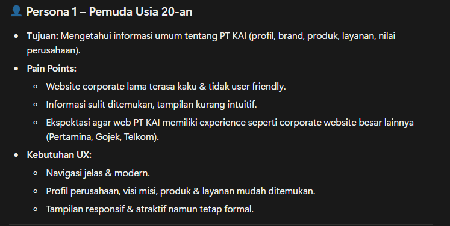

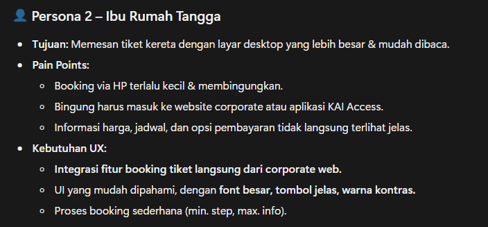

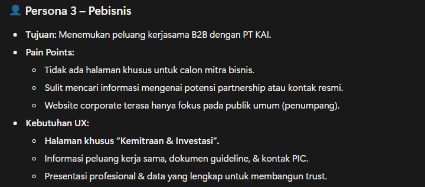

*Persona summaries supplied by KAI informed the redesign's focus on information access and different visitor needs.*

## 02 — Define: turning pain points into a design focus

I mapped the persona pain points into problem statements. The challenge was not simply to refresh the appearance: the website also needed to communicate its content and purpose more clearly.

Three priorities shaped the redesign:

- **Make corporate information easier to find.** Visitors needed clearer routes to KAI's profile, organisation, history, and services.
- **Clarify access to services and business information.** Visitors looking for booking or collaboration should not have to guess where to begin.
- **Modernise the presentation without losing its corporate character.** The interface needed to feel more engaging while remaining appropriate for an official company website.

The central design question became: how could the website help different visitors find relevant information while presenting KAI as a modern and approachable organisation?

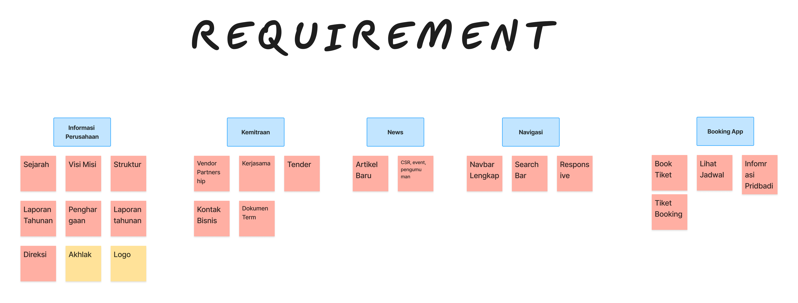

*The requirements board groups the information and navigation needs considered in the redesign.*

## 03 — Ideate: planning routes to the right information

With the problems defined, I created user flows to determine the pages and interactions needed for each journey. I also explored design references to inform the proposed interface.

The flows covered five areas: About Us, Services, Investor Relations, News, and Ticket Booking. Rather than designing each screen in isolation, I used these flows to connect the visitor's starting point with the information or action they were looking for.

For the company profile experience, this meant planning how visitors would move from the homepage into company information, explore KAI's services, access investor documents, or open a news article. The booking flow addressed a separate need identified in the supplied personas while remaining part of the wider website proposal.

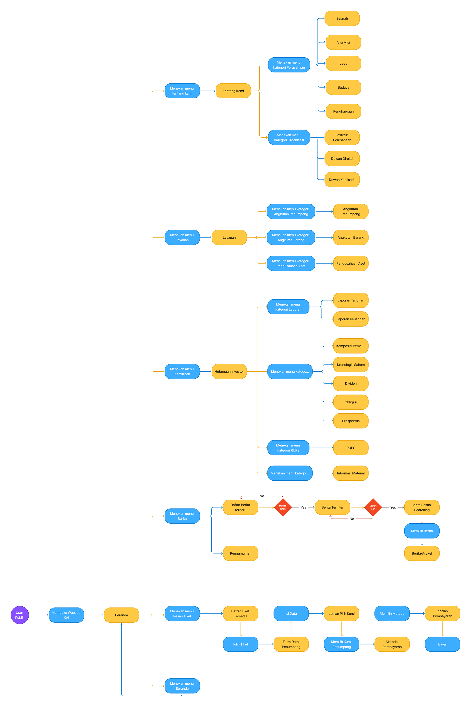

*User flows mapped routes from the homepage to the website's key destinations. Open the image preview to inspect the branches.*

## 04 — Prototype: giving the company profile a clearer visual structure

I developed wireframes to establish the page structure before translating them into a more detailed Figma prototype. This gave the navigation and content a tangible form that could be explored and tested.

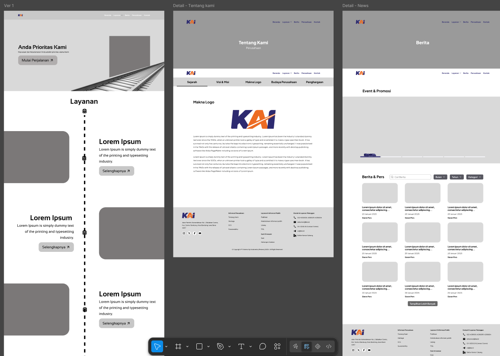

*Wireframes established page structure and content placement before the detailed interface design.*

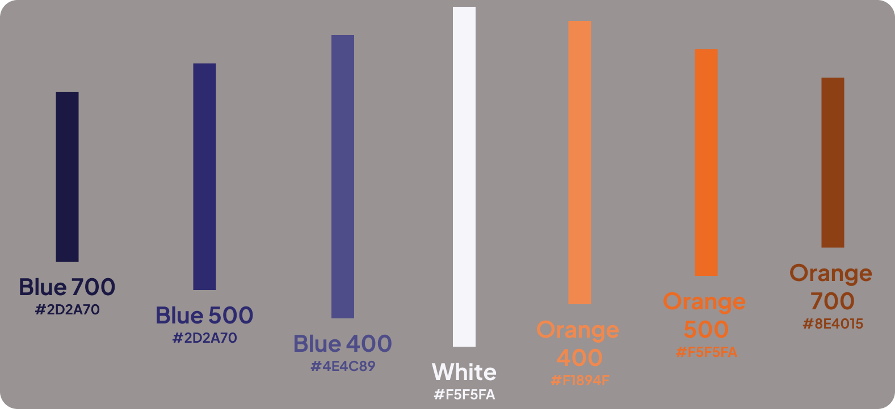

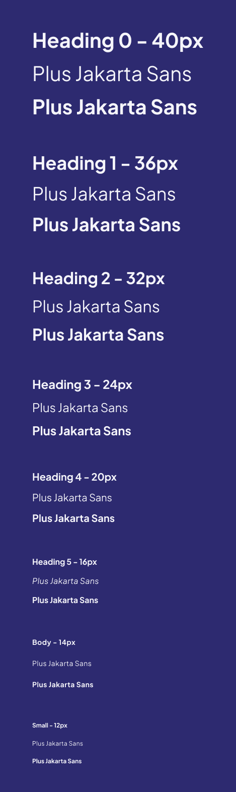

*Color and typography references used in the design proposal.*

The prototype included the homepage and pages for company history, the board of commissioners, investor information such as the prospectus and RUPS documents, passenger services, and news. Together, these screens demonstrated how the redesigned website could present both the company and the information its visitors needed.

### A homepage shaped by KAI's identity

The homepage proposal brought together an introduction to KAI, its services, group companies, and digital application. Train and railway imagery connected these sections to the company's identity.

One distinctive concept was a train journey shaped by scrolling: the train would move as visitors explored the page. This proposed interaction made the railway theme part of the browsing experience, rather than using it only as decoration.

### Corporate information beyond the homepage

The inner pages extended the redesign to practical information-seeking journeys. Company history and leadership introduced the organisation, investor pages presented corporate documents, and service and news pages helped visitors explore KAI's activities.

Ticket-booking screens were also included in the prototype to address the desktop-booking persona. They were a supporting part of the proposal, not a replacement for the website's company profile purpose.

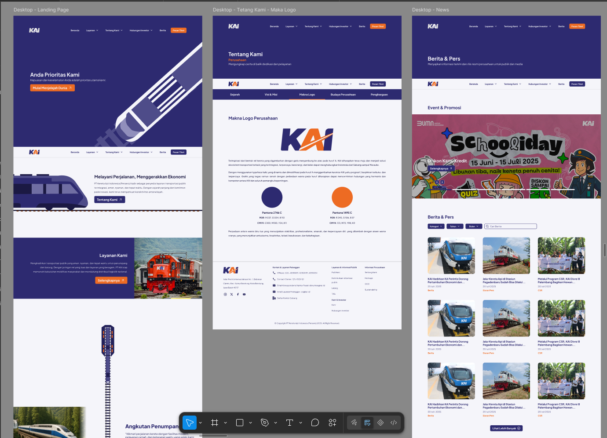

*Selected screens from the Figma prototype. These document the proposed interface, not a production website.*

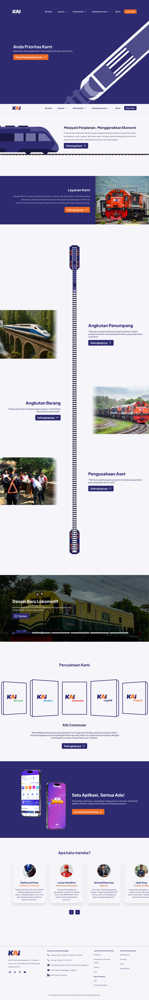

*The full homepage proposal combines corporate information and railway-inspired visuals. Content within the mockup illustrates the design proposal.*

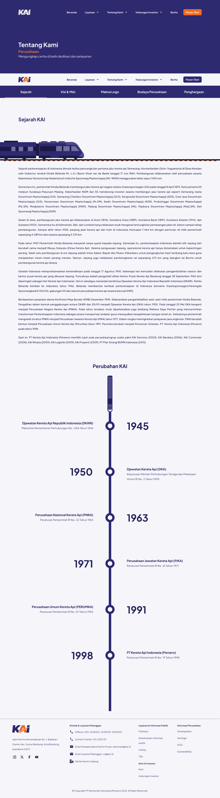

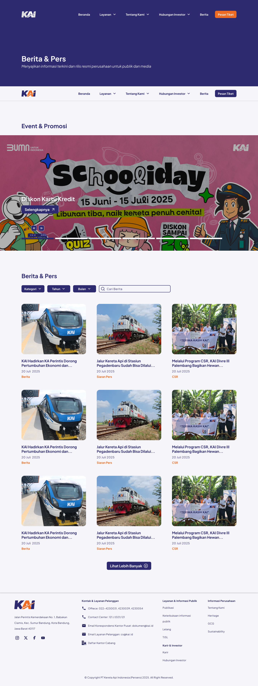

*Company history and news pages extend the design beyond the homepage. Full-size previews make the longer screens easier to inspect.*

## 05 — Test: evaluating how easily visitors could complete tasks

I evaluated the prototype with five participants across twelve task scenarios. After each task, participants rated its perceived ease on the seven-point Single Ease Question (SEQ) scale. I also asked for feedback to identify potential improvements beyond the numerical ratings.

The scenarios covered company information, services, booking, investor resources, news, and help contacts. This tested more than the homepage's appearance: it examined how easily participants could navigate to specific information and actions.

| Task | Mean SEQ score / 7 |
| --- | ---: |
| Find the company's vision and mission | 5.8 |
| View the organisational structure | 6.0 |
| View company awards | 6.2 |
| Explore company history | 6.4 |
| Find information about the President Commissioner | 6.2 |
| View passenger services | 6.8 |
| Complete the ticket-booking scenario | 6.6 |
| Find the annual report | 6.4 |
| View the dividend policy | 6.2 |
| Download the 2025 RUPS RKAP document | 6.6 |
| Find the specified news article about rail services in South Sulawesi | 6.6 |
| Find help contacts | 7.0 |

Across the twelve tasks, the overall mean was **6.4 out of 7**, calculated from the task averages in the internship report. Under the report's interpretation criteria, eleven tasks were rated “Very Easy” and one was rated “Easy.”

### What the evaluation revealed

Finding help contacts received the highest score at 7.0. Finding the company's vision and mission received the lowest score at 5.8, identifying a specific area for further refinement even though participants still rated it as easy.

The results provide encouraging evidence of perceived ease for the tested prototype. They do not establish a measured improvement over the original website, since the report does not include an equivalent baseline evaluation of the old design.

<!-- SS — TEST
Masukkan tabel skenario dan/atau hasil SEQ dari laporan (Tabel 2 dan 4).
Foto pengujian hanya bila tersedia dan ada izin peserta; samarkan identitas.
Caption: "Five participants evaluated twelve prototype tasks using the seven-point Single Ease Question scale."
Screenshot tabel penuh tidak wajib jika tabel pada halaman sudah cukup terbaca.
-->

## Outcome and reflection

The project resulted in user flows, wireframes, a Figma prototype, and a task-based usability evaluation for KAI's company profile website. It connected the supplied user research to a concrete design proposal and identified where further refinement was needed.

An important lesson was that usability and stakeholder alignment need to be developed together. While the evaluation produced positive ease-of-use ratings, the internship report also noted that some colour choices and train imagery did not fully match stakeholder expectations.

For future redesign work, I would validate visual direction and asset choices earlier, alongside navigation and page structure. I would also revisit the visibility of the vision and mission content, then test the revised journey. A successful corporate website needs to help visitors find information while representing the organisation in a way its stakeholders recognise and support.
